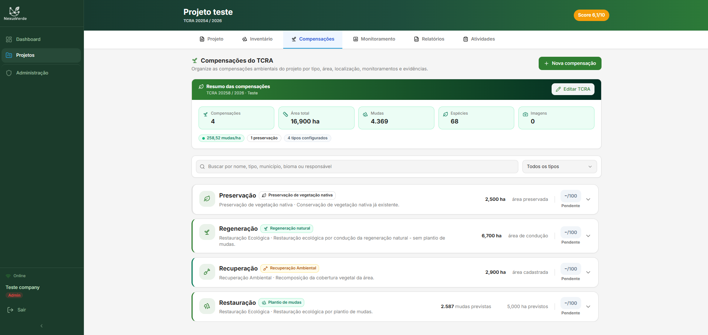
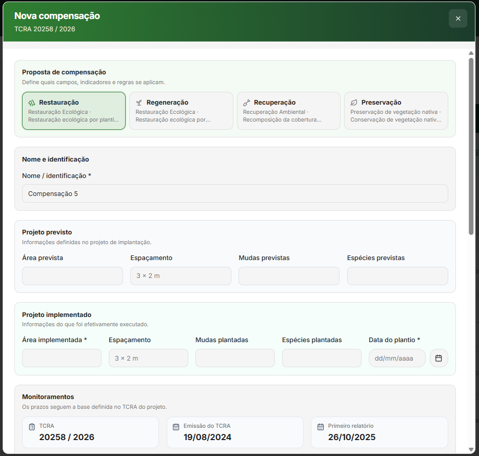
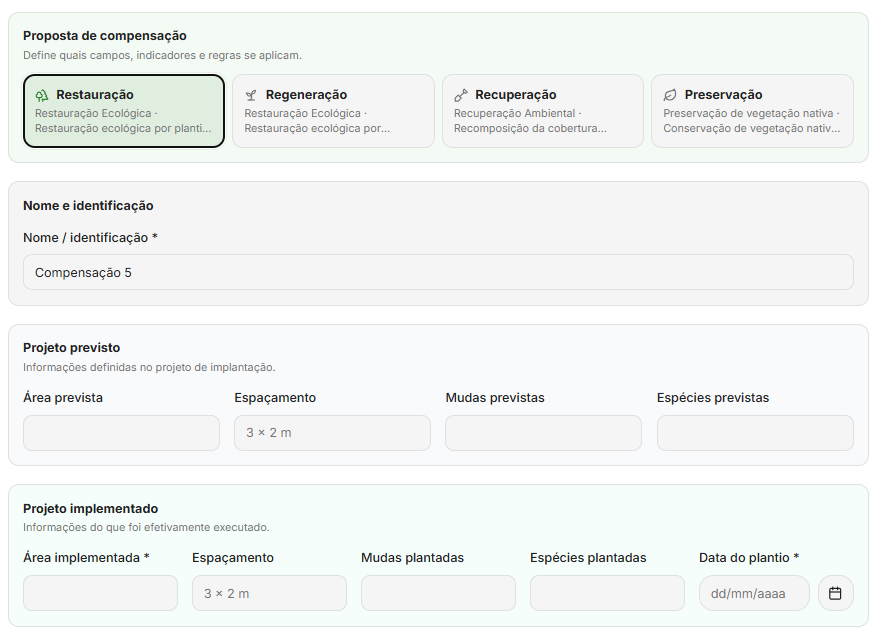
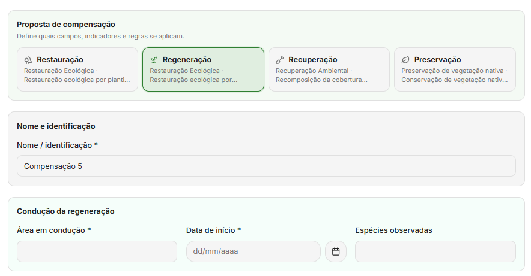
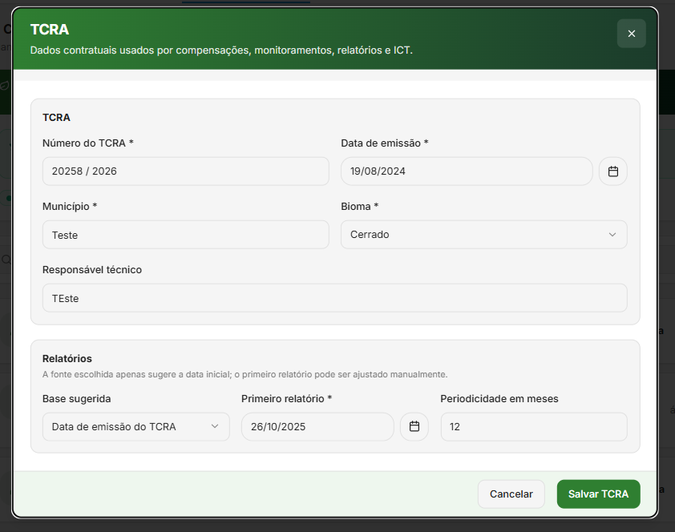
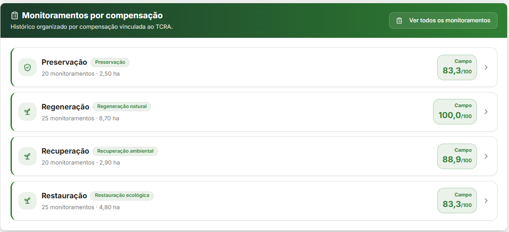
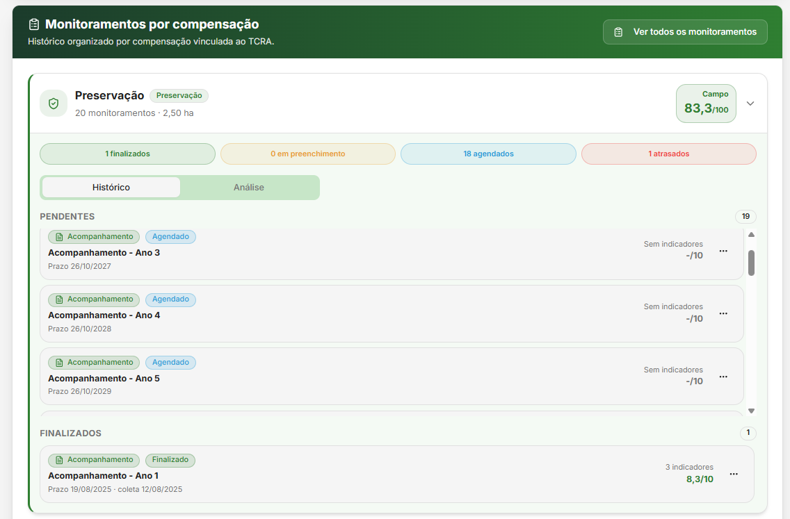
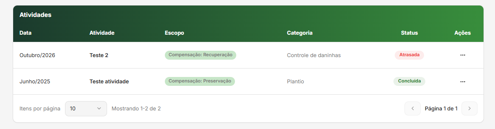
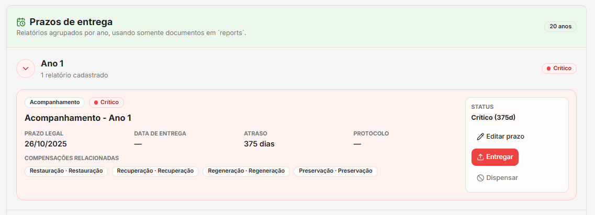
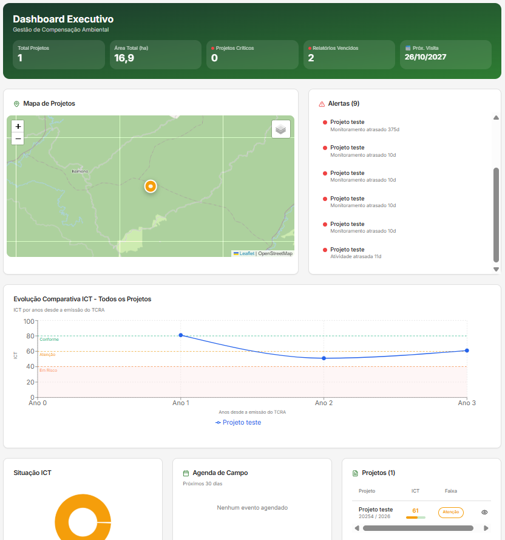

# Reestruturação do Gerenciamento de TCRA com Compensações

Este projeto apresenta a refatoração da rotina de **Plantio** da plataforma web Nexus Verde para o modelo de **Compensações**. A mudança permite representar, no mesmo projeto TCRA, diferentes obrigações ambientais com dados, monitoramentos, atividades, evidências e relatórios próprios.

O trabalho foi desenvolvido a partir de discussões e testes com a RV Urbanismo, empresa do ramo de loteamentos. O diagnóstico mostrou que um único TCRA pode reunir compensações de restauração, regeneração natural, recuperação ambiental e preservação de vegetação nativa. O modelo anterior de plantio único não representava adequadamente esse cenário.

---

## Funcionalidades

- Cadastro de múltiplas compensações no mesmo projeto TCRA
- Classificação por restauração, regeneração natural, recuperação ambiental e preservação
- Campos comuns e informações específicas conforme o tipo de compensação
- Registro de área, coordenadas, mudas, espécies, espaçamento, datas e observações
- Monitoramentos vinculados a cada compensação
- Indicadores configurados conforme o tipo e o modo de monitoramento
- Atividades gerais do projeto ou específicas por compensação
- Imagens e documentos associados ao contexto correto
- Relatórios vinculados a uma ou mais compensações
- Reprogramação de monitoramentos e relatórios após alteração da data do primeiro relatório
- Visão consolidada no projeto e no Dashboard
- Migração de plantios legados com preservação de rastreabilidade

---

## Telas da Rotina Compensações

## Lista de Compensações

Tela que apresenta as compensações cadastradas em um projeto, com tipo, situação, área, datas e informações resumidas.

<!-- Tirar print da guia Compensações com pelo menos duas compensações de tipos diferentes. Evite mostrar nomes ou dados reais de clientes. -->

  

---

## Cadastro de Compensação

Tela utilizada para criar uma nova compensação e selecionar seu tipo.

<!-- Tirar print do formulário mostrando nome, tipo, área, coordenadas e data. -->

  

---

## Campos Específicos por Tipo

O formulário altera os campos conforme a estratégia ambiental selecionada, mantendo somente os dados aplicáveis.

<!-- Tirar um print de restauração com campos planejados e implantados, e outro de regeneração, recuperação ou preservação com seus campos específicos. -->

  
  

---

## Informações do TCRA

Tela de configuração das informações gerais do TCRA, incluindo data de emissão, primeiro relatório e periodicidade.

<!-- Tirar print do bloco ou modal de informações do TCRA. Mostrar a opção de reprogramar itens existentes quando a data do primeiro relatório é alterada. -->

  

---

## Monitoramentos por Compensação

Tela que lista ou filtra monitoramentos de acordo com a compensação selecionada e seus indicadores aplicáveis.

<!-- Tirar print da guia Monitoramentos com o nome ou filtro da compensação e, se possível, os indicadores cadastrados. -->

  
  

---

## Atividades com Escopo

Tela de atividades gerais do projeto e de atividades associadas a uma compensação específica.

<!-- Tirar print da lista ou formulário que demonstre a indicação de escopo Geral ou Compensação. -->

  

---

## Relatórios Consolidados

Tela de relatórios que relaciona as compensações participantes de cada entrega e permite acompanhar prazos e situação.

<!-- Tirar print da guia Relatórios mostrando as compensações relacionadas, prazo e status do relatório. -->

  

---

## Dashboard e Visão do Projeto

Tela com o resumo consolidado das compensações, monitoramentos, atividades, prazos e índice de conformidade técnica.

<!-- Tirar print do Dashboard Executivo ou da guia Projeto com cards, mapa ou resumo das compensações. -->

  

---

## Migração de Dados

A reestruturação inclui scripts para migrar plantios legados para compensações, com modo de simulação, comparação de registros e preservação de identificadores de origem. Monitoramentos, indicadores, imagens, documentos, atividades e relatórios podem ser migrados para o novo modelo, mantendo rastreabilidade durante a transição.

---

## Tecnologias Utilizadas

- React
- TypeScript
- Vite
- Tailwind CSS
- Radix UI
- React Router
- React Hook Form e Zod
- Firebase Authentication
- Cloud Firestore
- Firebase Storage
- Cloud Functions
- Leaflet
- Recharts
- Vitest e Testing Library
- Git e GitHub
